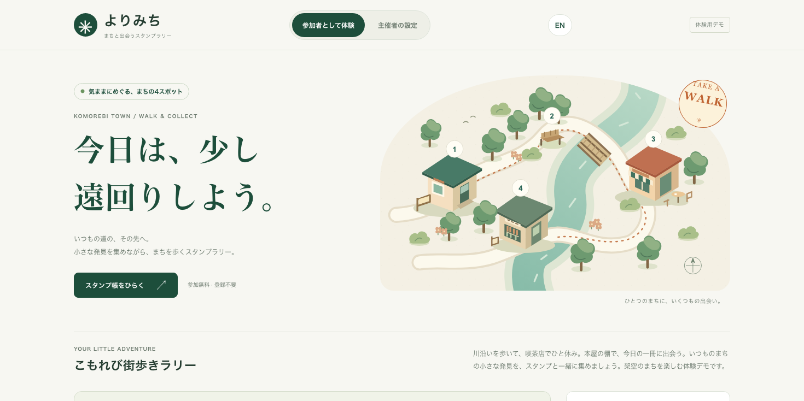

# StampRally

TypeScript 製のスタンプラリーエンジン。チェックイン、進捗・特典管理、参加者画面、管理画面を組み合わせて利用できます。ドメインエンジンは React や特定のストレージに依存しません。

A headless TypeScript stamp rally engine with check-ins, progress and rewards, participant views, and authoring tools. Choose the packages you need and connect your own storage and server.

## Packages / パッケージ

| Package | 用途 / Purpose |
| --- | --- |
| [@stamprally/core](packages/core/README.md) | 判定・進捗・保存・同期 / Domain engine, storage, and sync |
| [@stamprally/react](packages/react/README.md) | React Hook / `useStampRally` |
| [@stamprally/ui](packages/ui/README.md) | 参加者画面 / Participant components |
| [@stamprally/admin-ui](packages/admin-ui/README.md) | 設定編集・公開前チェック / Authoring and preflight checks |
| [@stamprally/server](packages/server/README.md) | サーバーでの検証・特典引換 / Server verification and reward claims |
| [@stamprally/mui](packages/mui/README.md) | Material UI の参加者・管理画面 / Material UI viewer and editor |

## Quick start / 導入

Node.js 22 以上。React パッケージは React 18 / 19 に対応しています。

Requires Node.js 22 or later. React packages support React 18 / 19.

```sh
pnpm add @stamprally/core @stamprally/react @stamprally/ui
```

サーバーで `toPublicConfig(adminConfig)` により生成した `publicConfig` を渡します。チェックインや特典引換を有効にするには、クライアントまたはサーバー連携アダプターを追加してください。

Pass `publicConfig` generated by `toPublicConfig(adminConfig)` on the server. Add a client or server-backed adapter to enable check-ins and reward claims.

```tsx
import { RallyViewer } from "@stamprally/ui";
import "@stamprally/ui/styles.css";

<RallyViewer config={publicConfig} locale="ja" />;
```

**設定の扱い / Configuration:** `AdminRallyConfig` は検証用の秘密情報を含むため公開しないでください。外部 JSON は `safeParseAdminConfig` / `safeParsePublicConfig` で検証します。本番の本人確認・チェックイン判定・特典在庫管理はサーバーで行います。

Keep `AdminRallyConfig` private: it contains verification secrets. Validate external JSON with `safeParseAdminConfig` / `safeParsePublicConfig`, and enforce identity, check-in verification, and reward inventory on the server in production.

## Demo / デモ

参加者のチェックイン・進捗・特典と、主催者の設定編集を試せます。日本語・英語の表示切替に対応しています。

Try participant check-ins, progress, rewards, and organizer settings. The demo supports Japanese and English.



```sh
pnpm install
pnpm dev
```

ブラウザーで [日本語](http://localhost:5173/) / [English](http://localhost:5173/?lang=en) を開きます。

## Development / 開発

Node.js 22 以上と pnpm 11 を使用してください。 / Use Node.js 22 or later and pnpm 11.

```sh
pnpm test
pnpm typecheck
pnpm lint
pnpm build
```

## Documentation / 詳細資料

- [Feature guide / 機能ガイド](docs/GUIDE.md): 表示のカスタマイズ、開催期間、巡回案内、特典条件、公開前チェック / Customization, availability, navigation, rewards, and preflight
- [Security / セキュリティ](docs/SECURITY_MODEL.md): サーバーの認証・検証・データ保護 / Server identity, verification, and data protection
- [Google auth and cloud sync / Google 認証・クラウド同期](docs/GOOGLE_AUTH_SYNC.md)
- [Examples / 実装例](examples): サーバー連携、Material UI、認証 / Server integration, Material UI, and authentication
- [Releasing / リリース手順](RELEASING.md)

## License

MIT
