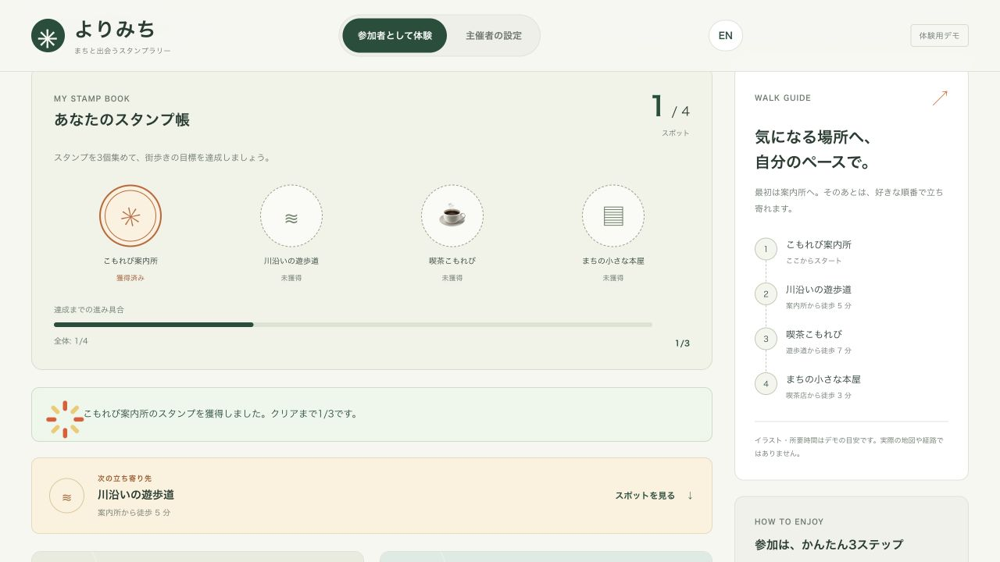
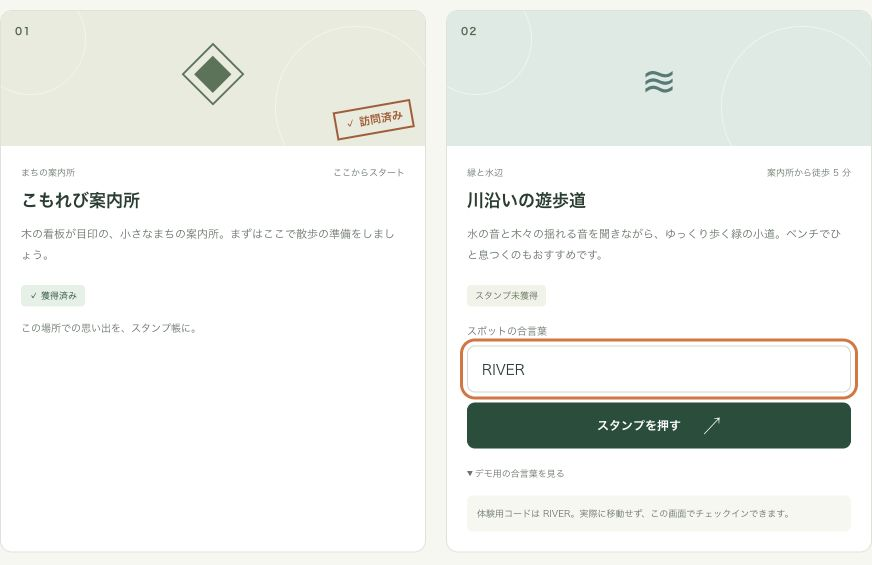
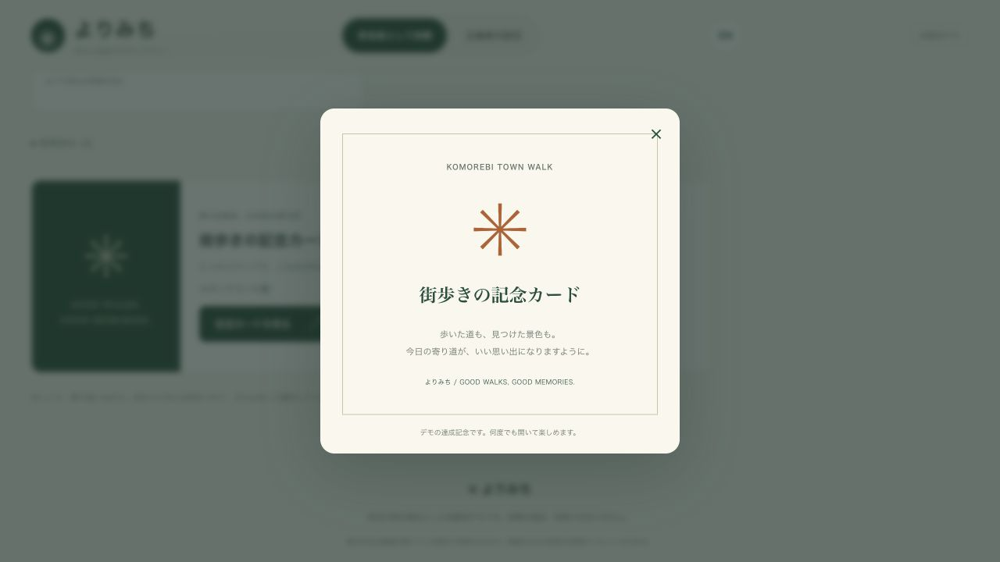
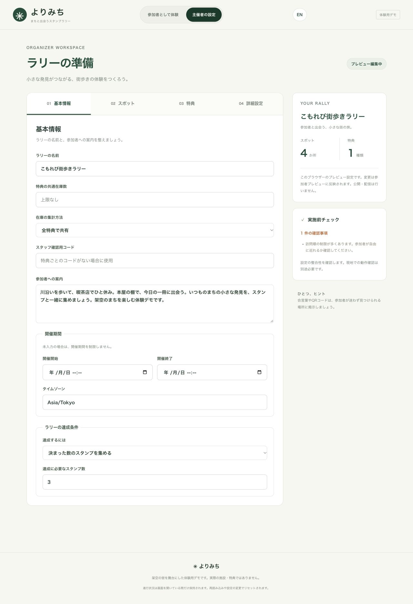

# StampRally

TypeScript 製のスタンプラリーエンジン。チェックイン、進捗・特典管理、参加者画面、管理画面を組み合わせて利用できます。ドメインエンジンは React や特定のストレージに依存しません。

A headless TypeScript stamp rally engine with check-ins, progress and rewards, participant views, and authoring tools. Choose the packages you need and connect your own storage and server.

## Packages / パッケージ

| Package | 用途 / Purpose |
| --- | --- |
| [@stamprally/core](packages/core/README.md) | 判定・進捗・保存・同期 / Domain engine, storage, and sync |
| [@stamprally/react](packages/react/README.md) | React Hook / `useStampRally` |
| [@stamprally/ui](packages/ui/README.md) | 参加者画面 / Participant components |
| [@stamprally/admin-ui](packages/admin-ui/README.md) | 設定編集・公開前チェック / Authoring and preflight checks |
| [@stamprally/server](packages/server/README.md) | サーバーでの検証・特典引換 / Server verification and reward claims |
| [@stamprally/mui](packages/mui/README.md) | Material UI の参加者・管理画面 / Material UI viewer and editor |

## Quick start / 導入

Node.js 22 以上。React パッケージは React 18 / 19 に対応しています。

Requires Node.js 22 or later. React packages support React 18 / 19.

```sh
pnpm add @stamprally/core @stamprally/react @stamprally/ui
```

サーバーで `toPublicConfig(adminConfig)` により生成した `publicConfig` を渡します。チェックインや特典引換を有効にするには、クライアントまたはサーバー連携アダプターを追加してください。

Pass `publicConfig` generated by `toPublicConfig(adminConfig)` on the server. Add a client or server-backed adapter to enable check-ins and reward claims.

```tsx
import { RallyViewer } from "@stamprally/ui";
import "@stamprally/ui/styles.css";

<RallyViewer config={publicConfig} locale="ja" />;
```

**設定の扱い / Configuration:** `AdminRallyConfig` は検証用の秘密情報を含むため公開しないでください。外部 JSON は `safeParseAdminConfig` / `safeParsePublicConfig` で検証します。本番の本人確認・チェックイン判定・特典在庫管理はサーバーで行います。

Keep `AdminRallyConfig` private: it contains verification secrets. Validate external JSON with `safeParseAdminConfig` / `safeParsePublicConfig`, and enforce identity, check-in verification, and reward inventory on the server in production.

## Demo / デモ

`apps/web` は、架空の「こもれび街歩きラリー」を体験できるデモアプリです。案内所・遊歩道・喫茶店・本屋の4スポットを巡り、スタンプを3個集めると記念カードを開けます。画面上部で参加者／主催者と日本語／英語を切り替えられます。

The `apps/web` demo takes you through the fictional Komorebi Town Walk: visit four places—a welcome center, riverside, café, and bookshop—and collect three stamps to unlock a keepsake. Switch between participant and organizer views, and Japanese and English, using the header controls.


### スタンプ取得と巡回案内 / Check-ins and walking guidance

案内所で最初のスタンプを取得すると、残りのスポットが解放されます。スタンプ帳で獲得数と達成までの進捗を確認し、次の立ち寄り先や街歩きガイドからスポットへ移動できます。

Collect your first stamp at the welcome center to unlock the other places. The stamp book tracks collected stamps and progress toward completion; the next-stop panel and walking guide link to each place.



<details>
<summary>合言葉によるチェックイン画面 / Passcode check-in</summary>

各スポットの「デモ用の合言葉を見る」でコードを確認し、入力して「スタンプを押す」を選びます。キャプチャは案内所が獲得済みで、遊歩道の合言葉を入力した状態です。実際の移動や位置情報の許可は不要です。

Expand “Show demo passcode,” enter the code, and select “Collect stamp.” The capture shows the welcome center already collected and the riverside passcode entered. No travel or location permission is needed.



</details>

### 達成特典 / Completion reward

3個のスタンプで目標達成となり、「記念カードを見る」からデジタル特典を表示できます。残りのスポットも続けて巡れます。

Three stamps complete the walking goal and unlock a digital reward through “View keepsake.” You can keep exploring the remaining place afterward.

<details>
<summary>記念カードのキャプチャ / Keepsake capture</summary>



</details>

### 主催者の設定 / Organizer settings

ラリー名・参加者への案内・開催期間・達成条件を編集できます。「スポット」「特典」「詳細設定」では、取得方法、特典条件、デザイン、設定JSONの入出力を管理できます。右側の概要と「実施前チェック」で、スポット・特典の数や設定の確認事項を把握できます。

Edit the rally title, participant guidance, dates, and completion rules. The Places, Rewards, and Advanced tabs cover check-in methods, reward requirements, design, and configuration JSON import/export. The sidebar summarizes places and rewards and highlights issues in the preflight checks.

<details>
<summary>主催者の設定画面 / Organizer workspace capture</summary>



</details>

### 試し方 / Try it locally

```sh
pnpm install
pnpm dev
```

ブラウザーで [日本語](http://localhost:5173/) / [English](http://localhost:5173/?lang=en) を開きます。

Open the demo in [Japanese](http://localhost:5173/) or [English](http://localhost:5173/?lang=en).

1. 案内所で `OPEN` を入力して最初のスタンプを取得します。 / Enter `OPEN` at the welcome center to collect your first stamp.
2. 遊歩道で `RIVER`、喫茶店で `COFFEE` を入力し、3個集めて記念カードを開きます。本屋は `BOOK` で試せます。 / Use `RIVER` at the riverside and `COFFEE` at the café to unlock the keepsake with three stamps. Try `BOOK` at the bookshop too.
3. 「主催者の設定」でラリーの条件を編集し、「参加者として体験」で変更を確認します。 / Edit the rally in Organizer settings, then switch to Participant view to see the changes.

進捗と設定はこのページを開いている間のプレビューです。再読み込みで初期状態に戻り、設定変更でも進捗がリセットされます。実際の施設・特典や公開・配信機能は含みません。

Progress and settings are an in-page preview. Reloading restores the defaults; changing settings also resets progress. The demo has no real facilities, rewards, or publishing/distribution flow.

## Development / 開発

Node.js 22 以上と pnpm 11 を使用してください。 / Use Node.js 22 or later and pnpm 11.

```sh
pnpm test
pnpm typecheck
pnpm lint
pnpm build
```

## Documentation / 詳細資料

- [Feature guide / 機能ガイド](docs/GUIDE.md): 表示のカスタマイズ、開催期間、巡回案内、特典条件、公開前チェック / Customization, availability, navigation, rewards, and preflight
- [Security / セキュリティ](docs/SECURITY_MODEL.md): サーバーの認証・検証・データ保護 / Server identity, verification, and data protection
- [Google auth and cloud sync / Google 認証・クラウド同期](docs/GOOGLE_AUTH_SYNC.md)
- [Examples / 実装例](examples): サーバー連携、Material UI、認証 / Server integration, Material UI, and authentication
- [Releasing / リリース手順](RELEASING.md)

## License

MIT
